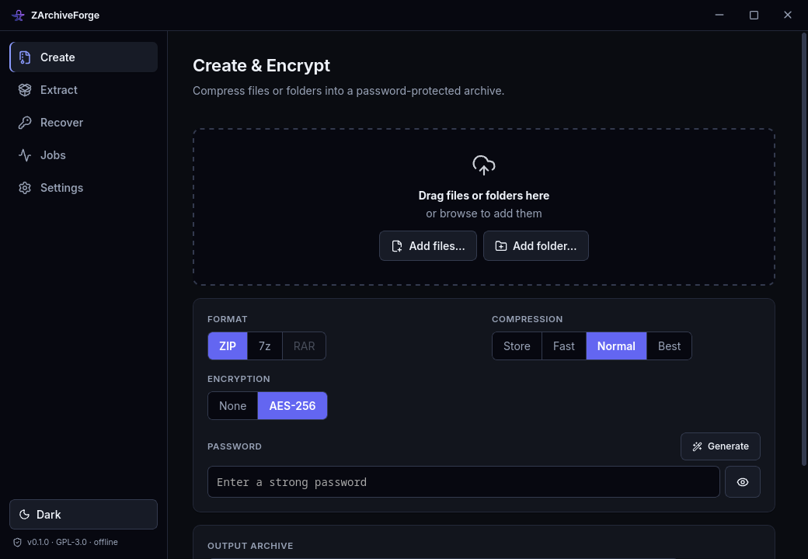
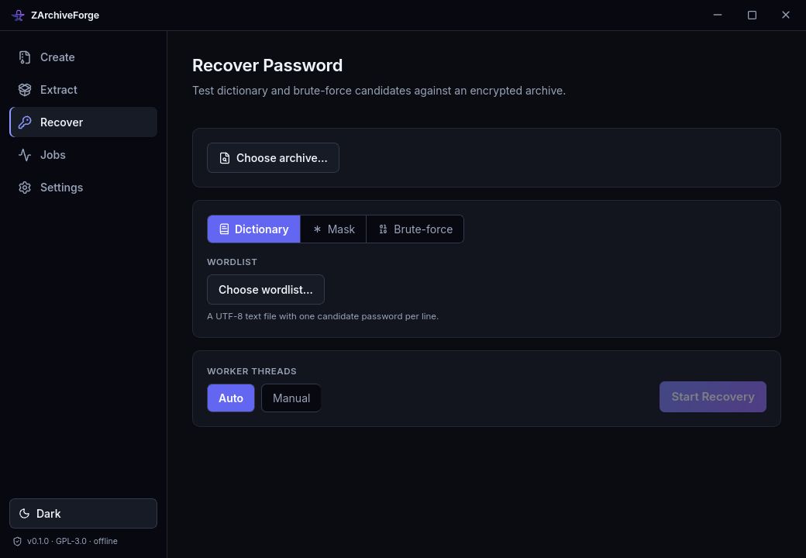
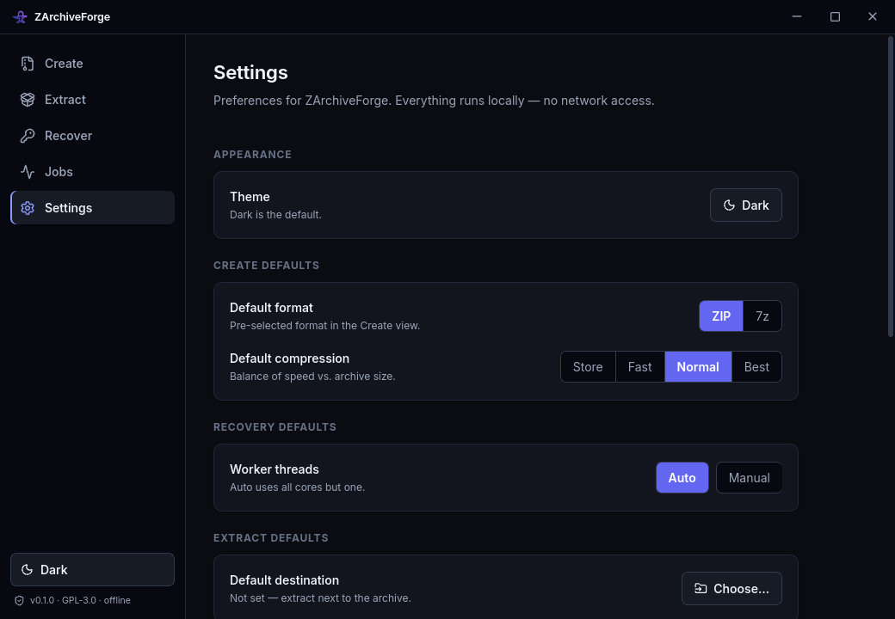

<div align="center">


# ZArchiveForge

**Offline archive encryptor, extractor & password-recovery toolkit.**

Create AES-256 encrypted archives, extract them again, and recover lost passwords —
all **100% offline**, on your own machine, with zero network calls and zero tracking.

<br />

[](#-download)
[](LICENSE)
[](#-tech-stack)
[](#-privacy--offline-guarantee)

<br />

**[⬇ Download](https://zsync.eu/zarchiveforge/)** &nbsp;·&nbsp;
**[✨ Features](#-features)** &nbsp;·&nbsp;
**[📸 Screenshots](#-screenshots)** &nbsp;·&nbsp;
**[🚀 Quick start](#-quick-start)** &nbsp;·&nbsp;
**[🛠 Build from source](#-build-from-source)**

</div>

---

## What is ZArchiveForge?

ZArchiveForge is a small, fast, native **desktop app** that does three jobs around
password-protected archives — and does them without ever touching the internet:

| | | |
|---|---|---|
| 🔒 **Create & encrypt** | Pack files and folders into **ZIP** or **7z** with real **AES-256** encryption. | Optional **RAR** via your own `rar` binary. |
| 📦 **Extract** | Unpack **ZIP** and **7z** archives — decrypting them with a password when needed. | Safe against zip-slip path attacks. |
| 🔑 **Recover passwords** | Forgot a password to *your own* archive? Recover it with **dictionary**, **mask**, and **brute-force** attacks. | Live speed/ETA, pause & resume. |

It's built for the moments where a general-purpose archive manager stops being enough:
you need strong encryption you can trust, or you're locked out of an archive **you own**
and need a way back in — without uploading anything to a stranger's "online zip cracker."

> [!IMPORTANT]
> **Password recovery is for archives you own or are authorized to access.** ZArchiveForge
> is a local, offline tool for legitimate recovery, security testing, and education. You are
> responsible for using it only on data you have the right to access.

---

## 👥 Who is it for?

- **Anyone who locked themselves out** of an old encrypted ZIP/7z and remembers *part* of the
  password (perfect for mask attacks) or used a word from a list they still have.
- **Privacy-minded people** who want to encrypt files with AES-256 before putting them on a
  USB stick, cloud drive, or email — without trusting a web service.
- **IT / sysadmins & power users** who handle protected archives and want a scriptable-feeling,
  offline, no-nonsense tool.
- **Security students & CTF players** who want a clean, visual playground for how dictionary,
  mask, and brute-force attacks actually behave (real passwords/sec, real keyspace math).
- **Developers** who appreciate a tidy Rust + Tauri codebase with a proper backend/frontend
  contract and integration tests.

---

## ✨ Features

### 🔒 Create & encrypt
- Pack **files and/or whole folders** into a single archive (folder structure preserved).
- **Formats:** ZIP and 7z natively; **RAR** creation via an external `rar` binary you install.
- **Encryption:** real **AES-256** (ZIP AES and 7z AES) — not the weak legacy ZipCrypto.
- **Compression levels:** Store / Fast / Normal / Best.
- **Drag-and-drop** files onto the window, or pick them with a dialog.
- **Password strength meter** and a built-in **cryptographically-secure password generator**
  (adjustable length + character classes, copy to clipboard).
- Auto-suggested output path that you can override at any time.

### 📦 Extract
- Unpack **ZIP** and **7z**, entering a password only if the archive is encrypted.
- **Live entry preview** — see what's inside (names, sizes, which entries are encrypted)
  *before* you extract.
- Choose any destination folder; a sensible default is suggested.
- **Zip-slip safe:** malicious `../` or absolute paths inside an archive can never escape your
  chosen folder.
- One-click **"Show folder"** to reveal the result in your file manager.

### 🔑 Recover passwords (ZIP & 7z)
Three attack strategies, each with a **live "what will be tried" preview** that shows the exact
candidates the engine will test next:

- **📖 Dictionary** — point it at any wordlist (one candidate per line; handles huge, even
  non-UTF-8 lists gracefully).
- **✳️ Mask** — when you remember the *shape* of the password. Build patterns from
  `?l ?u ?d ?s ?a` plus literal characters (e.g. `Summer?d?d?d?d`).
- **🔢 Brute-force** — pick character sets (lower/upper/digits/symbols/space or your own) and a
  length range.

Plus:
- **Real-time metrics:** passwords/sec, progress %, elapsed time, and **ETA**.
- **Pause & resume** — long jobs write on-disk **checkpoints** so you can stop and pick up later
  from the exact position (survives app restarts).
- **Multi-core** CPU cracking (Rayon), with an auto or manual thread count.
- A **Jobs** view with expandable cards: full config, count tried, current position, and a live
  "recently tried" feed.
- Honest guidance: the app warns you when a scheme (7z / AES-256) uses deliberately slow key
  derivation, so brute-force is only realistic for short or dictionary-known passwords.

### ⚙️ Preferences that actually stick
- Persistent defaults for **format, compression, worker threads, and extract destination**.
- A configurable path to your **`rar` binary** (with a one-click **Test** button).
- **Checkpoint management** — review, delete, or clear saved recovery checkpoints.
- Light / dark theme (dark by default).

### 🎨 Polished, native desktop UX
- Custom cross-platform titlebar, **system tray** (show / quit / click-to-restore).
- Toast notifications, tasteful iconography, self-hosted fonts (nothing loaded from the web).
- Small, fast, single-window app — feels instant.

---

## 📸 Screenshots

> Dark theme shown. ZArchiveForge ships with light and dark modes.

<div align="center">

### Create & encrypt


### Recover a password


### Settings


</div>

---

## ⬇ Download

Prebuilt installers for **Windows, macOS (Intel & Apple Silicon), and Linux** are on the
official page:

### 👉 **[zsync.eu/zarchiveforge](https://zsync.eu/zarchiveforge/)**

| Platform | Formats |
|---|---|
| **Windows** | `.exe` (NSIS installer) · `.msi` |
| **macOS** | `.dmg` (Apple Silicon & Intel) |
| **Linux** | `.AppImage` · `.deb` · `.rpm` |

Every release ships with a `SHA256SUMS.txt` so you can verify your download.

> **macOS note:** builds are ad-hoc signed. On first launch you may need to right-click → **Open**
> (or allow it in *System Settings → Privacy & Security*).

---

## 🚀 Quick start

### Create an encrypted archive
1. Open the **Create** tab.
2. Drag files/folders in (or click to browse).
3. Choose **ZIP** or **7z**, keep **AES-256** on, and type a password — or hit **Generate** for a
   strong one.
4. Pick where to save it and click **Create Archive**.

### Extract an archive
1. Open the **Extract** tab and choose an archive.
2. Review the entry preview; enter the password if it's encrypted.
3. Choose a destination and click **Extract** → **Show folder**.

### Recover a forgotten password
1. Open the **Recover** tab and choose your encrypted ZIP/7z.
2. Pick an attack: **Dictionary** (load a wordlist), **Mask** (e.g. `?u?l?l?l?d?d?d?d`), or
   **Brute-force** (charset + length range).
3. Watch the **"what will be tried"** preview, then **Start Recovery**.
4. Track speed/ETA in **Jobs** — **pause** anytime and **resume** later from the checkpoint.

---

## 🔐 A note on RAR

The RAR format is **proprietary**, and that shapes what any GPL app can legally do:

- **Creating RAR** — no open-source library can produce a valid `.rar`, so ZArchiveForge shells
  out to a `rar` binary **you install yourself** (RARLAB's, from WinRAR/RAR). Nothing proprietary
  is bundled or linked — it's arm's-length process execution, which keeps ZArchiveForge GPL-clean.
  Set its path in **Settings**, or leave it on auto (PATH / common WinRAR locations).
- **Extracting / cracking RAR** — **not supported.** The UnRAR library's license adds a restriction
  that is incompatible with GPL-3.0, so its code is never included. ZIP and 7z have no such
  limitation and are fully native for create, extract, **and** recover.

---

## 🛡 Privacy & offline guarantee

- **No network code, period.** No telemetry, no update pings, no "cloud."
- Everything — encryption, extraction, cracking, checkpoints, settings — happens **locally** and
  stays on your disk.
- Fonts are self-hosted and bundled; the UI never fetches anything from the web.

---

## 🛠 Build from source

### Prerequisites
- **Rust** (stable) + **Cargo**
- **Node.js** 20+ and **pnpm**
- **Tauri v2 system dependencies** for your OS — see the
  [Tauri prerequisites guide](https://v2.tauri.app/start/prerequisites/).
  On Debian/Ubuntu that's roughly: `libwebkit2gtk-4.1-dev`, `libayatana-appindicator3-dev`,
  `librsvg2-dev`, `libssl-dev`, `libxdo-dev`, `build-essential`, `pkg-config`.

### Run in development
```bash
pnpm install
pnpm tauri dev        # launches the app with hot-reload
```

### Build installers
```bash
pnpm tauri build      # produces native installers for your platform
```

### Run the tests
```bash
# Backend: create / extract / crack round-trips, checkpoints, wire shapes
cargo test --manifest-path src-tauri/Cargo.toml

# Frontend typecheck + production build
pnpm build
```

### Optional: enable RAR creation
Install WinRAR/RAR so a `rar` binary is on your `PATH`, set `ZAF_RAR_BIN` to its full path, or
just point to it in **Settings → RAR support**.

---

## 🧱 Tech stack

**Rust · Tauri v2 · React 19 · TypeScript · Vite · pnpm**

| Layer | What it does |
|---|---|
| **Rust backend** (`src-tauri/`) | Archive create/extract, the multi-threaded crack engine (Rayon), verifiers, checkpoints, and the Tauri command surface. |
| **React frontend** (`src/`) | The UI: Create / Extract / Recover / Jobs / Settings views, a typed IPC layer, and Zustand stores. |
| **Encryption/format crates** | [`zip`](https://crates.io/crates/zip) (AES-256), [`sevenz-rust2`](https://crates.io/crates/sevenz-rust2) (7z AES). |

Progress streams from Rust to the UI over a Tauri `Channel`; crack jobs run on a dedicated thread
with an adaptive batch size so pause/progress stay responsive, and resume seeks back to an exact
candidate index from the checkpoint.

---

## ❓ FAQ

**Is this a "hacking" tool?**
It's a recovery and security tool. Use it on archives you own or are authorized to test. ZArchiveForge
doesn't throttle itself — it cracks flat-out on all cores. But AES/7z **key derivation is intentionally
slow by the archive format's own design**, which caps how fast *any* tool (including this one) can test
guesses, so brute-forcing an unknown strong password isn't feasible. That's exactly why dictionary and
mask attacks (using what *you* remember) exist — they cut how many guesses you need, not how long each
one takes.

**Why can't I crack RAR?**
Licensing — see [the RAR note](#-a-note-on-rar). ZIP and 7z are fully supported.

**Does it work offline?**
Completely. There is no network code in the app at all.

**Where are my settings and checkpoints stored?**
Settings live in the app's local storage; recovery checkpoints are JSON files under the OS app-data
directory. You can clear checkpoints from **Settings**.

---

## 👤 Author & license

Created by **[TheHolyOneZ](https://github.com/TheHolyOneZ)** · more projects at
**[zsync.eu](https://zsync.eu)**.

Licensed under the **GNU General Public License v3.0 or later** (GPL-3.0-or-later).
See [`LICENSE`](LICENSE).

<div align="center">
<br />
<sub>Made with 🦀 + ⚛️ · 100% offline · <a href="https://zsync.eu/zarchiveforge/">zsync.eu/zarchiveforge</a></sub>
</div>
